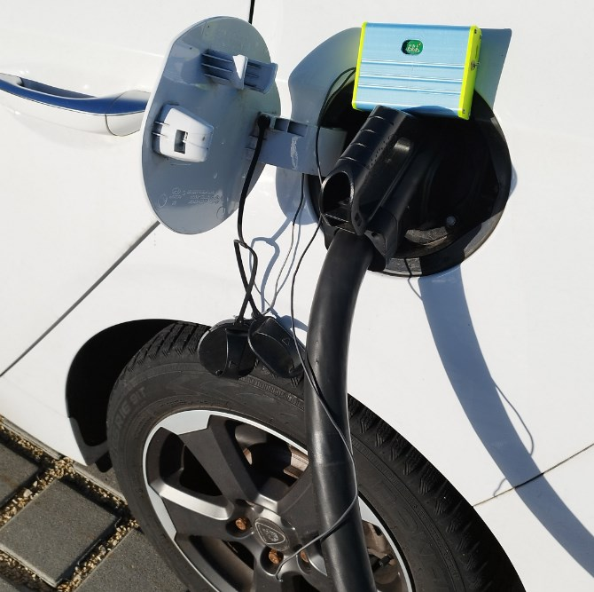
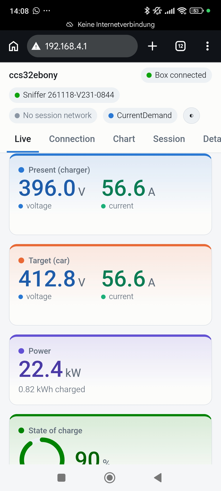
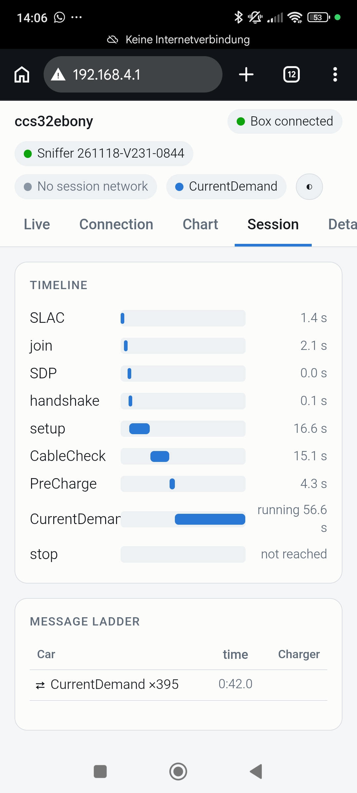
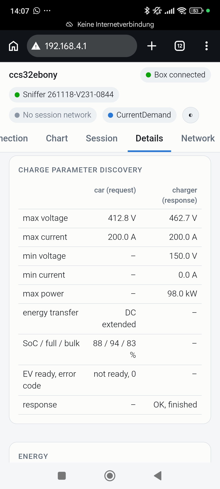
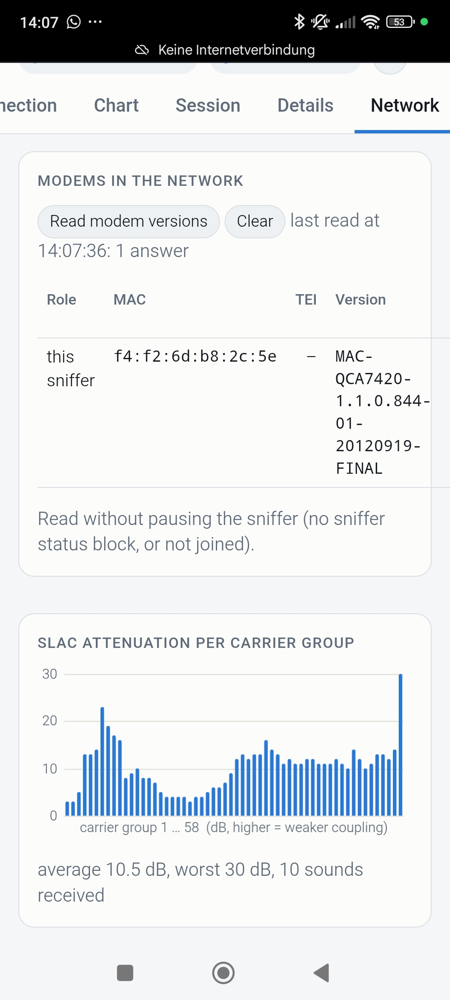

# ccs32ebony

A passive CCS charging-session viewer for the **WT32-ETH01** (ESP32 + LAN8720 Ethernet) board.
It watches the communication between an electric vehicle (PEV) and a DC charger (EVSE) and shows
the decoded data on a **tablet or phone**, over a Wi-Fi access point that the board creates itself.

> **Status: field-tested.** On 2026-11-21 the box followed several complete DC charging sessions of
> a Hyundai Ioniq on an alpitronics charger: SLAC, SDP and the V2G exchange in both directions, up
> to CurrentDemand (about 22 kW in the session shown below). Before that it was tested on the
> bench, with a Foccci as car and pyPLC as charger. Open items: [docs/backlog.md](docs/backlog.md).



The modem is sensitive enough that no clamp or coupler is needed: its RF wires just hang next to
the charging cable at the charge port, and it still picks up the whole session.

| Live view | Session timing | Charge parameters | SLAC attenuation |
|---|---|---|---|
|  |  |  |  |

## How it works

```
  PEV  ── CP/PE ──┬── EVSE
                  │  (HomePlug Green PHY on the control pilot line)
                  │
        TP-Link TL-PA4010P (AR7420)
        running the transparent sniffer firmware
                  │  Ethernet (raw frames: SLAC MMEs, IPv6/SDP, TCP/V2G)
                  │
             WT32-ETH01 (ESP32)
             - receives all Ethernet frames (promiscuous, no IP stack on Ethernet)
             - decodes HomePlug / SLAC, SDP, TCP, V2GTP, EXI (DIN 70121)
             - Wi-Fi access point + web server + WebSocket
                  │  Wi-Fi
                  │
             Tablet / phone browser
             - live values, phases, charts, message ladder, log, export
```

The powerline modem is a **TP-Link TL-PA4010P** running the transparent sniffer firmware from the
QCA7000/AR7420 transparency project. That firmware is published as a patch script in
[pyPLC](https://github.com/uhi22/pyPLC) (folder `ar7420-sniffer-patch/`). It overhears the SLAC
handshake, joins the network that the car and charger set up, and forwards all SLAC, SDP and V2G
traffic in **both directions** to its Ethernet port. The box checks at runtime that the modem
runs the sniffer build.

The project follows [ccs32dave](https://github.com/uhi22/ccs32dave), which shows the same kind of
data on a small ILI9341 TFT using a QCA7005 modem on SPI. ccs32ebony makes two changes:

| | ccs32dave | ccs32ebony |
|---|---|---|
| MCU | ESP32-S3 | ESP32 (WT32-ETH01) |
| Modem link | QCA7005 over SPI | TL-PA4010P (AR7420) over Ethernet |
| Display | 240×320 TFT, one push button | any browser (tablet/phone) over Wi-Fi |
| History | what fits on the screen | the browser keeps the whole session, and it can be exported |

The protocol code (HomePlug, TCP reassembly, V2GTP, the OpenV2G EXI decoder) is ported from
ccs32dave.

## What the tablet shows

- **Live:** present and target voltage and current, power, SoC, the phase strip with durations,
  and the last message. Updated with every decoded message.
- **Chart:** voltage, current, power and SoC over the whole session, with a crosshair and a table
  view.
- **Session:** the phase timeline and a message ladder between car and charger.
- **Details:** SDP, protocol handshake, charge parameters of car and charger, energy, and identity
  and keys (masked until tapped).
- **Network:** frames, the local modem (sniffer build, joined or not), the box, the SLAC
  attenuation profile, and on request the firmware versions of all modems in the network.
- **Sniffer:** the sniffer firmware's own status (v158 or newer): which TEI it learned for the car
  and when, the traffic it caught per direction, modem uptime and restarts, and management
  messages it dropped. With an unjoined sniffer build (v214..v299): the modem's status frame, which the box
  switches on by itself.
- **Log:** every SLAC, SDP and V2G message, filterable, with export to JSON and CSV.

## Quick start

1. Flash the modem with the sniffer firmware (see the patch's README in pyPLC) and couple it to
   the CP line: [docs/hardware-setup.md](docs/hardware-setup.md).
2. Copy `ebony_config.example.h` to `ebony_config.h` and set a Wi-Fi password (at least 8
   characters).
3. Build and upload (esp32 core 3.x):
   ```sh
   arduino-cli compile --fqbn esp32:esp32:wt32-eth01 --output-dir build .
   arduino-cli upload  --fqbn esp32:esp32:wt32-eth01 -p <port> --input-dir build .
   ```
4. Connect the modem to the WT32-ETH01 by Ethernet, power both, join the Wi-Fi `ccs32ebony` with
   the tablet, and open `http://192.168.4.1/`.

## Documentation

- [docs/concept.md](docs/concept.md): goals, architecture, data path, firmware modules, risks
- [docs/hardware-setup.md](docs/hardware-setup.md): WT32-ETH01, modem, wiring, flashing, serial commands
- [docs/web-ui.md](docs/web-ui.md): the tablet user interface and the WebSocket protocol
- [docs/backlog.md](docs/backlog.md): done and open work items

## ⚠️ Safety and legal notes

- This is a **sniffer**. It captures traffic between other parties (car and charger), including
  identifiers and the network key of the session. Use it only on vehicles and charging sessions you
  are **authorised** to monitor.
- The device is **passive**: it never sends V2G messages and has no IP stack on Ethernet. Its
  only Ethernet frames are a few HomePlug management queries, sent as unicast to its *own* local
  modem.
- Flashing the modem firmware can brick the modem. See the warnings in the sniffer patch's README.
- Anything connected to a charging inlet or cable is handled at your own risk. DC charging involves
  dangerous voltages.

## Licence

**GPL-3.0**, see [LICENSE](LICENSE). The project reuses code from ccs32dave and pyPLC (both
GPL-3.0). The OpenV2G EXI codec in `src/exi/` keeps its own licence (LGPL-3.0, see its file
headers).

## Support

ccs32ebony is a spare-time project. If it's useful for you, you can support further development:

- Patreon: https://www.patreon.com/uhi22
- PayPal: https://www.paypal.me/uhi22
